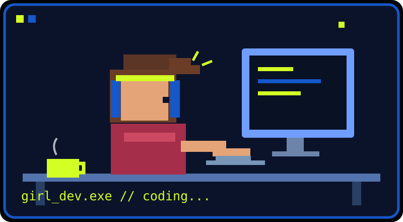

  

  **Yazılım Mühendisliği Öğrencisi · Backend · Veri · Yapay Zekâ**

  [🇹🇷 Türkçe](#türkçe) · [🇬🇧 English](#english) · [LinkedIn](https://www.linkedin.com/in/esmanur-kelesoglu/)

---

## 🇹🇷 Türkçe

### Merhaba, ben Esmanur 👋
Kocaeli Üniversitesi Yazılım Mühendisliği son sınıf öğrencisiyim. Gerçek problemleri çalışan uygulamalara dönüştürmeyi, özellikle backend, veri ve kullanıcı deneyimi alanlarında üretmeyi seviyorum.

### ⭐ Öne Çıkan Proje — Green Construction

**🌱 Green Construction** · **Climathon (UP School × Siemens)** · [🔗 Canlı demo](https://green-construction-eight.vercel.app)

TS 825:2024 standardına göre, belirli bir bütçe içinde en uygun **yalıtım ve pencere paketini** bulan karar destek aracı.

- TS 825'in aylık hesap yöntemini kodlayan Python hesap motoru — standardın çözümlü örnekleriyle doğrulanan 431 test
- Araç çağırma ve sayı denetimiyle rakam uydurmasını engelleyen yapay zekâ asistanı (Gemini, yedek: Groq)
- 81 ili iklim bölgesine göre gösteren Türkiye haritası, şehre özel öneriler ve müteahhit için tek sayfalık rapor

🏆 **144 proje arasından ilk 20** · 👩‍💻 **Tek kişilik ekip**

`Python` `FastAPI` `Gemini API` `Groq` `Vercel`

Kaynak kodu özel depoda tutuluyor; talep üzerine demo yapılabilir.

### 🚀 Diğer çalışmalar
- **TUSAŞ LIFT UP — Bitirme projesi (devam ediyor):** Ekip olarak satış sonrası ürünlerde konfigürasyon takibi ve yapay zekâ destekli arıza karar mekanizması geliştiriyoruz.
- **Dijital Gebelik Takibi — TÜBİTAK 2209-A:** Ekip olarak gebelik takibini destekleyen mobil sağlık araştırma projesi.

### 💻 Seçili projeler
| Proje | Çözdüğü problem | Teknolojiler | Durum |
|---|---|---|---|
| [WiFi Pulse](https://github.com/esmanurkls/wifi-pulse) | Yurt internetinin hızını ve gecikmesini ölçer, katları karşılaştırır, kesinti bildirimi sunar | Next.js, TypeScript, Supabase, PostgreSQL, Recharts | 🟢 [Canlı](https://wifi-pulse.vercel.app) · kod açık |
| [Görev Yönetim Sistemi](https://github.com/esmanurkls/Gorev-Yonetim-Sistemi) | JWT girişi, görev öncelikleri, son tarihler, filtreleme ve istatistikler | Django REST, React, PostgreSQL / SQLite, Chart.js | Kod açık |
| [Image Repository](https://github.com/esmanurkls/Image-Repository) | Görselleri object storage'da, metadata'yı veritabanında tutan çok servisli uygulama; kalıcı volume'lar | Django, PostgreSQL, MinIO, Docker Compose | Kod açık |

### 🧩 Deneyim
- **POSCO ASSAN TST — Bilgi İşlem stajı:** QR tabanlı İSG bildirimi ve vardiya planlama süreçleri; C#, ASP.NET Web Forms, SQL Server, DevExpress.
- **SET Yazılım — Yazılım stajı:** Kurumsal web ekranları ve SQL Server veri işlemleri.

### 🤝 Topluluklar
- **KOÜ Yazılım Kulübü:** Sponsorluk çalışmaları ve Base41 hackathon planlaması.
- **DevFest Kocaeli 2025:** Tasarım ekibi ve konuşmacı asistanlığı.

### 🛠️ Bildiğim teknolojiler

  

Ayrıca: SQL Server, ASP.NET Web Forms, DevExpress, MinIO.

**Derinleştirdiğim alanlar:** Yapay zekâ uygulamaları, veri, backend mimarisi (ASP.NET Core, Docker) ve ürün yönetimi.

---

## 🇬🇧 English

### Hey, I'm Esmanur 👋
I'm a final-year Software Engineering student at Kocaeli University. I enjoy turning real-world problems into practical applications, especially where backend systems, data and user experience meet.

### ⭐ Featured Project — Green Construction

**🌱 Green Construction** · **Climathon (UP School × Siemens)** · [🔗 Live demo](https://green-construction-eight.vercel.app)

A decision-support tool that finds the best **insulation and window package** within a given budget, based on the Turkish thermal insulation standard **TS 825:2024**.

- Python calculation engine implementing the TS 825 monthly method — 431 tests validated against the standard's worked examples
- AI assistant (Gemini, Groq as fallback) that uses tool calls and number checks so it never invents figures
- Climate-zone map of all 81 provinces, city-specific recommendations and a one-page report for contractors

🏆 **Top 20 out of 144 projects** · 👩‍💻 **Solo project**

`Python` `FastAPI` `Gemini API` `Groq` `Vercel`

Source code is private; a demo is available on request.

### 🚀 Other work
- **TUSAŞ LIFT UP — Capstone (ongoing):** As a team, working on product configuration tracking and AI-assisted fault decision support for after-sales processes.
- **Digital Pregnancy Tracking — TÜBİTAK 2209-A:** A collaborative mobile-health research project supporting pregnancy follow-up.

### 💻 Selected projects
| Project | Problem & solution | Stack | Status |
|---|---|---|---|
| [WiFi Pulse](https://github.com/esmanurkls/wifi-pulse) | Community-sourced dorm Wi-Fi speed and latency tests, floor comparisons and outage reports | Next.js, TypeScript, Supabase, PostgreSQL, Recharts | 🟢 [Live](https://wifi-pulse.vercel.app) · public code |
| [Task Management System](https://github.com/esmanurkls/Gorev-Yonetim-Sistemi) | JWT-based login, task priorities, deadlines, filtering and statistics dashboard | Django REST, React, PostgreSQL / SQLite, Chart.js | Public code |
| [Image Repository](https://github.com/esmanurkls/Image-Repository) | Multi-service app storing images in object storage and metadata in a database, with persistent volumes | Django, PostgreSQL, MinIO, Docker Compose | Public code |

### 🧩 Experience
- **POSCO ASSAN TST — IT intern:** Internal application workflows including QR-based occupational safety reporting and shift planning; C#, ASP.NET Web Forms, SQL Server, DevExpress.
- **SET Yazılım — Software intern:** Enterprise web interfaces and SQL Server data operations.

### 🤝 Community
- **KOÜ Software Club:** Sponsorship activities and Base41 hackathon planning.
- **DevFest Kocaeli 2025:** Design team and speaker assistance.

### 🛠️ Technologies I know

  

Also: SQL Server, ASP.NET Web Forms, DevExpress, MinIO.

**Currently deepening:** AI applications, data, backend architecture (ASP.NET Core, Docker) and product management.

---

