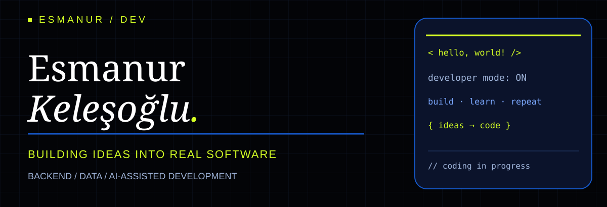
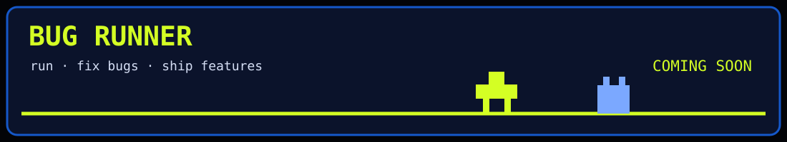

  

  **Software Engineering Student · Backend · Data · AI**

  [🇬🇧 English](#english) · [🇹🇷 Türkçe](#türkçe) · [LinkedIn](https://www.linkedin.com/in/esmanur-kelesoglu/)

---

## 🇬🇧 English

### Hey, I'm Esmanur 👋
I'm a final-year Software Engineering student at Kocaeli University. I enjoy turning real-world problems into practical applications, especially where backend systems, data and user experience meet.

### 🚀 Featured work
- **TUSAŞ LIFT UP — Capstone (ongoing):** With my teammate Meryem Güldüren, working on product configuration tracking and AI-assisted fault decision support for after-sales processes.
- **Green Construction — Climathon:** Independently built a TS 825-informed decision-support tool to find insulation and window combinations within a budget. **Top 20 of 144 projects.** (Private repository.)
- **Digital Pregnancy Tracking — TÜBİTAK 2209-A:** Developed with Elif Altun as a collaborative mobile-health research project supporting pregnancy follow-up.

### 💻 Selected projects
| Project | Problem & solution | Stack | Status |
|---|---|---|---|
| [WiFi Pulse](https://github.com/esmanurkls/wifi-pulse) | Community-sourced dorm Wi-Fi speed and latency tests, floor comparisons and outage reports | Next.js, TypeScript, Supabase, PostgreSQL, Recharts | Public code; deployment unverified |
| [Task Management System](https://github.com/esmanurkls/Gorev-Yonetim-Sistemi) | JWT-based login, task priorities, deadlines, filtering and statistics dashboard | Django REST, React, PostgreSQL / SQLite, Chart.js | Public code; deployment unverified |
| [Team AI Workflow](https://github.com/esmanurkls/team-ai-workflow) | Repeatable planning, code review, verification and handoff for AI-assisted team development | Node.js, JavaScript, Markdown | Public workflow template |

### 🧩 Experience
- **POSCO ASSAN TST — IT intern:** Internal application workflows including QR-based occupational safety reporting and shift planning; C#, ASP.NET Web Forms, SQL Server, DevExpress.
- **SET Yazılım — Software intern:** Enterprise web interfaces and SQL Server data operations.

### 🤝 Community
- **KOÜ Software Club:** Sponsorship activities and Base41 hackathon planning.
- **DevFest Kocaeli 2025:** Design team and speaker assistance.

### 🛠️ Technologies
**Used in projects or internships:** C#, ASP.NET Web Forms, SQL Server, DevExpress, Python, Django REST, JavaScript, TypeScript, React, Next.js, HTML, CSS, Flutter, PostgreSQL, Supabase, Git.

**Currently deepening:** ASP.NET Core, Docker, backend architecture, applied machine learning.

---

## 🇹🇷 Türkçe

### Merhaba, ben Esmanur 👋
Kocaeli Üniversitesi Yazılım Mühendisliği son sınıf öğrencisiyim. Gerçek problemleri çalışan uygulamalara dönüştürmeyi, özellikle backend, veri ve kullanıcı deneyimi alanlarında üretmeyi seviyorum.

### 🚀 Öne çıkan çalışmalar
- **TUSAŞ LIFT UP — Bitirme projesi (devam ediyor):** Meryem Güldüren ile birlikte satış sonrası ürünlerde konfigürasyon takibi ve yapay zekâ destekli arıza karar mekanizması geliştiriyoruz.
- **Green Construction — Climathon:** TS 825'i referans alarak bütçe içindeki yalıtım ve pencere seçeneklerini değerlendiren karar destek aracını tek başıma geliştirdim. **144 proje arasından ilk 20.** (Özel depo.)
- **Dijital Gebelik Takibi — TÜBİTAK 2209-A:** Elif Altun ile birlikte gebelik takibini destekleyen mobil sağlık araştırma projesi.

### 💻 Seçili projeler
| Proje | Çözdüğü problem | Teknolojiler | Durum |
|---|---|---|---|
| [WiFi Pulse](https://github.com/esmanurkls/wifi-pulse) | Yurt internetinin hızını ve gecikmesini ölçer, katları karşılaştırır, kesinti bildirimi sunar | Next.js, TypeScript, Supabase, PostgreSQL, Recharts | Kod açık; canlı sürüm doğrulanmadı |
| [Görev Yönetim Sistemi](https://github.com/esmanurkls/Gorev-Yonetim-Sistemi) | JWT girişi, görev öncelikleri, son tarihler, filtreleme ve istatistikler | Django REST, React, PostgreSQL / SQLite, Chart.js | Kod açık; canlı sürüm doğrulanmadı |
| [Team AI Workflow](https://github.com/esmanurkls/team-ai-workflow) | Yapay zekâ destekli ekip geliştirmesinde planlama, inceleme, doğrulama ve devir süreci | Node.js, JavaScript, Markdown | Açık iş akışı şablonu |

### 🧩 Deneyim
- **POSCO ASSAN TST — Bilgi İşlem stajı:** QR tabanlı İSG bildirimi ve vardiya planlama süreçleri; C#, ASP.NET Web Forms, SQL Server, DevExpress.
- **SET Yazılım — Yazılım stajı:** Kurumsal web ekranları ve SQL Server veri işlemleri.

### 🤝 Topluluklar
- **KOÜ Yazılım Kulübü:** Sponsorluk çalışmaları ve Base41 hackathon planlaması.
- **DevFest Kocaeli 2025:** Tasarım ekibi ve konuşmacı asistanlığı.

### 🛠️ Teknolojiler
**Kullandıklarım:** C#, ASP.NET Web Forms, SQL Server, DevExpress, Python, Django REST, JavaScript, TypeScript, React, Next.js, HTML, CSS, Flutter, PostgreSQL, Supabase, Git.

**Derinleştirdiklerim:** ASP.NET Core, Docker, backend mimarisi, uygulamalı makine öğrenmesi.

---

<h3>🎮 Bug Runner</h3>

Visual concept only, not yet playable. / Şimdilik görsel konsept, henüz oynanabilir değil.

